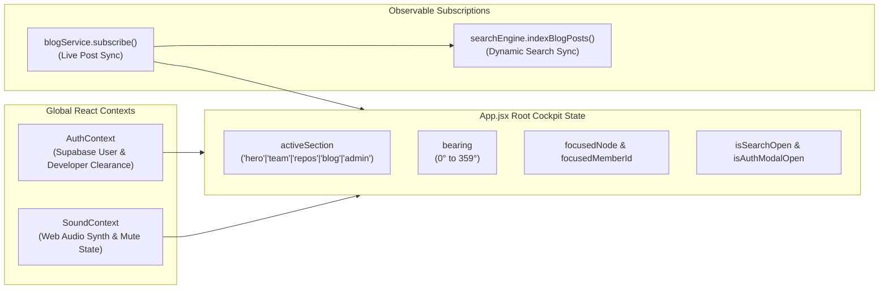
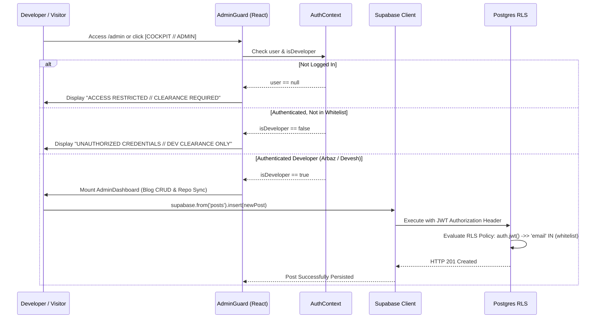

# 🏛️ System Architecture Specification // AceDevs

This document provides a comprehensive technical overview of the **AceDevs** system architecture, component topology, data flows, 3D WebGL render pipeline, algorithmic search engine, and security model.

---

## 1. High-Level Architecture Overview

AceDevs is engineered as a high-performance **Single Page Application (SPA)** built with **Vite 5** and **React 18**, operating on a hybrid client-first paradigm with headless cloud synchronization:

```mermaid
graph TD
    subgraph Browser ["Client Runtime (Browser)"]
        UI["Tactical HUD Cockpit (React 18)"]
        Canvas["3D WebGL Constellation (Three.js v0.186)"]
        Audio["Procedural Web Audio Engine"]
        Search["In-Memory Trie & Inverted Index"]
        Cache["localStorage Caching Layer"]
    end

    subgraph External ["External Services"]
        GH["GitHub REST API (v3)"]
        SupaAuth["Supabase GoTrue (Google OAuth 2.0 / Password)"]
        SupaDB["Supabase PostgreSQL (RLS Protected)"]
    end

    UI -->|Render Loop / Azimuth Sync| Canvas
    UI -->|Sound Trigger Dispatch| Audio
    UI -->|Cmd+K Query (Sub-ms)| Search
    UI -->|Fetch / Cache| Cache
    Cache -->|Fallback / TTL Refresh| GH
    UI -->|Session Handshake| SupaAuth
    UI -->|CRUD Publications| SupaDB
```

### Architectural Principles

1. **Zero-Latency Interactions**: Critical workflows (such as global multi-tag search, 3D constellation interaction, sound effects, and section transitions) operate entirely in-memory on the client without waiting for remote server roundtrips.
2. **Resilient Offline Grace**: When network connections drop, API limits are reached, or backend credentials are unconfigured, the system automatically falls back to deterministic local datasets (`mockRepos.js`, `blogPosts.js`) and a mock auth client (`FallbackMockAuthClient`), preventing blank screens or unhandled exceptions.
3. **Decoupled Viewport HUD**: The Tactical HUD acts as an independent viewport perimeter framing the interactive 3D WebGL scene beneath it, synchronizing azimuth bearing angles and section states via lightweight callbacks.

---

## 2. Component Hierarchy & Layering

The application layout is structured in layered Z-index planes to maintain the illusion of an operational sci-fi digital twin interface:

```
Z-Index Layering:
├── [Z-0]   Background Canvas Layer (.cyber-canvas-container)
│           └── Three.js WebGL Perspective Scene (Nodes, Splines, Particles)
│
├── [Z-10]  Main Content Viewport (.hud-main-content)
│           ├── Hero Sector (.hero-sector)
│           ├── Team Showcase (.team-section)
│           ├── Collective Repos (.repos-section)
│           ├── Engineering Blog (.blog-section / .article-reader)
│           └── Admin Cockpit (.admin-dashboard)
│
├── [Z-50]  Tactical Viewport HUD (.viewport-hud-frame)
│           ├── Top Perimeter Header (Branding, Search Trigger, Audio Toggle)
│           ├── Right Telemetry Rail (Compass Rosette, Azimuth Dial, Zoom)
│           ├── Bottom Status Bar (Coordinates, System Uptime, Auth Gateway)
│           └── Viewport Corner Brackets ([00], [01], [02], [03])
│
└── [Z-100] Global Modals & Overlays
            ├── Algorithmic Search Modal (.search-modal-backdrop)
            ├── Developer Auth Gateway (.auth-modal-backdrop)
            └── Interactive Node Tooltip (.cyber-node-tooltip)
```

---

## 3. 3D WebGL Constellation Pipeline

The hero section and ambient backdrop are powered by a custom **Three.js** WebGL canvas encapsulated in `CyberCanvas.jsx` and `CyberNodeNetwork.jsx`.

### 3.1 Lifecycle & Context Provider

`CyberCanvas` creates and maintains the core Three.js primitives via `CyberCanvasContext`:
- **`THREE.Scene`**: Dark space background (`#020a19`) with exponential fog (`THREE.FogExp2(0x020a19, 0.015)`).
- **`THREE.PerspectiveCamera`**: 55° FOV, initial position `[0, 2, 28]`, near clip `0.1`, far clip `1000`.
- **`THREE.WebGLRenderer`**: Anti-aliased, `powerPreference: 'high-performance'`, `ACESFilmicToneMapping` (exposure `1.15`), and dynamic `pixelRatio` capped at `1.75` for GPU efficiency.
- **`THREE.Timer`**: Frame-independent delta timing powering shader uniform updates and orbital physics (migrated from deprecated `THREE.Clock`).

### 3.2 CyberNodeNetwork Topology

The 3D scene visualizes interconnected system clusters:
- **`DEV-01`**: Arbaz Arshad node (`[-6.5, 2.8, 2.5]`).
- **`DEV-02`**: Devesh Das node (`[6.5, -1.8, -2.5]`).
- **`SYS-01`**: Core Engine node (`[0.0, 4.2, -3.8]`).
- **`SRCH-01`**: AI & Trie Search node (`[-4.2, -3.8, 3.2]`).
- **`AUTH-01`**: Supabase Backend node (`[4.8, 3.6, 2.8]`).
- **`REPO-01`**: GitHub Aggregator node (`[-3.5, 2.2, -4.5]`).
- **`BLOG-01`**: Technical Blog CMS node (`[3.2, -3.2, 4.2]`).

### 3.3 Shader Architecture & Render Loop

Nodes are interconnected by 3D spline lines powered by a custom GLSL shader:
- **Vertex Shader**: Transforms spline vertices and passes normalized line length coordinates (`vUv`) to the fragment shader.
- **Fragment Shader**: Generates a moving high-luminescence pulse wave traversing along the line based on `time` uniforms:

$$\text{pulse} = \sin(vUv.x \cdot 10.0 - \text{time} \cdot 3.0)$$

- **Camera Damping**: Smooth spherical orbital camera movement based on mouse drag and azimuth bearing inputs, using exponential damping ($L_p = \text{target} \cdot 0.05 + \text{current} \cdot 0.95$).
- **Section Dimming**: When the user navigates into lower content sections (Team, Repos, Blog, Admin), `.cyber-canvas-container.dimmed` applies a 75% opacity reduction and CSS blur filter to ensure 100% typography legibility.

---

## 4. State Management Topology

The application relies on focused, single-responsibility state layers:



1. **`AuthContext`**: Wraps the application and monitors the active Supabase GoTrue session. Determines whether the authenticated user possesses developer clearance based on `VITE_DEV_EMAILS`.
2. **`SoundContext`**: Manages audio mute state (persisted to `localStorage`), starts/stops the ambient drone, and provides triggers for procedural sound effects (`playClick`, `playHover`, `playKeypress`, `playModalOpen`, `playAccessDenied`).
3. **`blogService` (Observable)**: Implements the Observer pattern (`subscribe(callback)`). When a post is created, updated, or deleted, all subscribers (including the UI and the client search index) are instantly notified.

---

## 5. Algorithmic Search Engine Architecture

Search operates entirely client-side using a zero-dependency dual data structure:

```
Search Query Input (e.g. "game")
       │
       ├──► PrefixTrie: Searches prefix token in O(k)
       │    └── Yields Autocomplete Suggestions & Matching Entity IDs
       │
       └──► InvertedIndex: Multi-Term Boolean Set Intersections
            ├── Term "game"    ──► Posting List: [dev-01, dev-02, repo-101, post-01]
            ├── Term "physics" ──► Posting List: [dev-02, repo-102]
            └── Intersection (AND) ──► Result Set: [dev-02]
```

- **`PrefixTrie.js`**: An algorithmic prefix tree where each node holds character transitions, end-of-word flags, associated document IDs, and usage frequency weights. Autocomplete suggestions are returned with zero latency.
- **`InvertedIndex.js`**: Maintains a dictionary mapping tokenized terms and taxonomy tags to sets of document IDs (`Posting Lists`). Supports boolean query operations (single term, multi-term `AND` intersection, multi-term `OR` union).
- **Indexing Pipeline**: On initialization, `searchEngine.js` ingests team members, system architecture nodes, repositories, and technical articles into the index. When new blog posts are published via the Admin dashboard, `blogService` triggers an automatic incremental re-index.

---

## 6. Security & Authorization Architecture

The platform enforces a layered defense-in-depth model for developer admin capabilities:



### Row-Level Security (RLS) Guarantees

- **Public Viewers**: Can perform `SELECT` queries strictly on records where `published = true`.
- **Authorized Developers**: Authenticated users whose email matches `VITE_DEV_EMAILS` can perform `SELECT`, `INSERT`, `UPDATE`, and `DELETE` on all records (including drafts).

---

## 7. Web Audio Procedural Synthesis Graph

Audio is generated mathematically using Web Audio API nodes, eliminating the bandwidth overhead and loading latency of static `.wav` or `.mp3` files:

```
[Ambient Drone Pipeline]:
OscillatorNode (55Hz Sawtooth) ──► BiquadFilterNode (Lowpass 180Hz) ──► GainNode (0.04) ──► AudioDestination
OscillatorNode (55.4Hz Detuned) ──► BiquadFilterNode (Lowpass 220Hz) ──► GainNode (0.03) ──► AudioDestination

[UI Micro-Sound Pipeline]:
OscillatorNode (Sine/Triangle) ──► GainNode (Exponential Decay Envelope) ──► AudioDestination
```

- **Ambient Drone**: Dual detuned oscillators create a subtle sci-fi sub-bass beating frequency resembling a spacecraft reactor or server room.
- **Clicks & Keystrokes**: Short sinusoidal tone bursts (40ms duration) with sharp exponential gain decay curves.
- **Access Denied**: Dual dissonant square wave pulses (150Hz + 110Hz) for error feedback.
