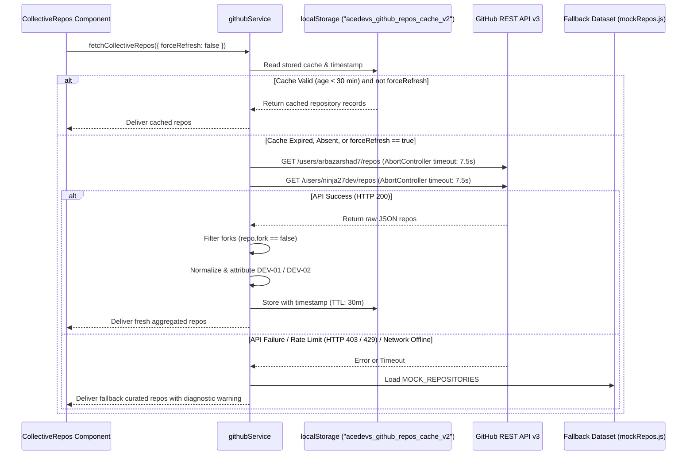

# ⚙️ Services & API Layer Specification // AceDevs

This document details the external integrations, state stores, caching layers, and communication services powering **AceDevs**.

---

## 1. Automated GitHub Pipeline: `githubService.js`

Located at [`src/services/githubService.js`](file:///d:/Work/AceDevs/src/services/githubService.js).

### 1.1 Overview & Responsibilities

The GitHub Service aggregates, normalizes, caches, and attributes open-source repositories from both Co-Founders (**Arbaz Arshad** and **Devesh Das**) via the official GitHub REST API v3.

### 1.2 Pipeline Architecture



### 1.3 Normalization Schema

Every raw GitHub repository payload is transformed into the AceDevs HUD schema:

```javascript
function normalizeRepo(rawRepo, ownerInfo) {
  return {
    id: rawRepo.id,
    name: rawRepo.name,
    fullName: rawRepo.full_name,
    description: rawRepo.description || 'Public software repository and architectural artifact.',
    htmlUrl: rawRepo.html_url,
    homepage: rawRepo.homepage || null,
    stars: rawRepo.stargazers_count || 0,
    forks: rawRepo.forks_count || 0,
    language: rawRepo.language || 'Code',
    topics: Array.isArray(rawRepo.topics) && rawRepo.topics.length > 0
      ? rawRepo.topics
      : [rawRepo.language?.toLowerCase() || 'project'],
    updatedAt: rawRepo.updated_at || new Date().toISOString(),
    archived: rawRepo.archived || false,
    owner: ownerInfo // { id: 'arbaz'|'devesh', code: 'DEV-01'|'DEV-02', name: '...' }
  };
}
```

### 1.4 API Methods

| Method | Parameters | Returns | Description |
| :--- | :--- | :--- | :--- |
| `fetchCollectiveRepos(options)` | `{ forceRefresh: boolean, ttlMs: number, token?: string }` | `Promise<Repo[]>` | Aggregates repositories for both developers with caching and fallback. |
| `clearReposCache()` | `None` | `void` | Evicts the `localStorage` repository cache. |

---

## 2. Supabase Integration: `supabaseClient.js`

Located at [`src/services/supabaseClient.js`](file:///d:/Work/AceDevs/src/services/supabaseClient.js).

### 2.1 Configuration & Health Checking

The Supabase client initializes via `@supabase/supabase-js`. It inspects `import.meta.env.VITE_SUPABASE_URL` and `import.meta.env.VITE_SUPABASE_ANON_KEY`:

```javascript
const isValidUrl = typeof envUrl === 'string' && envUrl.startsWith('http') && !envUrl.includes('your-project');
const isValidKey = typeof envAnonKey === 'string' && envAnonKey.length > 20 && !envAnonKey.includes('your-supabase-anon-key');

export const isConfigured = Boolean(isValidUrl && isValidKey);
```

### 2.2 Resilient Offline Mock Client (`FallbackMockAuthClient`)

If valid credentials are not found, the module instantiates a `FallbackMockAuthClient` instead of throwing an unhandled exception:
- **`getSession()`**: Returns mock active session persisted in `localStorage` (`acedevs_mock_auth_session`).
- **`onAuthStateChange(cb)`**: Emits auth state events identical to Supabase GoTrue.
- **`signInWithPassword({ email, password })`**: Authenticates developers locally, setting user metadata and simulating JWT bearer tokens.
- **`signOut()`**: Clears mock session and notifies listeners.

---

## 3. Blog Engineering Service: `blogService.js`

Located at [`src/services/blogService.js`](file:///d:/Work/AceDevs/src/services/blogService.js).

### 3.1 Architecture & Pub-Sub Pattern

`BlogService` acts as an observable data store implementing the Publisher-Subscriber pattern. Components subscribe via `blogService.subscribe(callback)`:

```javascript
// Example component subscription
useEffect(() => {
  const unsubscribe = blogService.subscribe((posts) => {
    setBlogPosts(posts.filter((p) => p.published !== false));
  });
  return () => unsubscribe();
}, []);
```

### 3.2 Dual-Layer Persistence

```
Client Operation (createPost / updatePost / deletePost)
       │
       ├──► 1. Supabase Postgres Table: 'posts' (If isConfigured == true)
       │       └── Insert / Update / Delete executed via REST API
       │
       ├──► 2. Local Storage Cache: 'acedevs_admin_posts'
       │       └── Immediate local sync ensuring instant UI updates
       │
       ├──► 3. Notify Subscribers: this._notify()
       │       └── All mounted React components re-render seamlessly
       │
       └──► 4. Search Engine Synchronization: searchEngine.indexBlogPosts()
               └── In-memory Trie and Inverted Index updated in real-time
```

### 3.3 CRUD Methods Reference

| Method | Parameters | Returns | Description |
| :--- | :--- | :--- | :--- |
| `getPosts()` | `None` | `Promise<Post[]>` | Retrieves all posts (both published and drafts for admin view). |
| `getPublishedPosts()` | `None` | `Promise<Post[]>` | Retrieves only published articles for public readers. |
| `getPostById(idOrSlug)` | `string` | `Promise<Post\|null>` | Finds an article by unique ID or URL slug. |
| `createPost(postData)` | `Partial<Post>` | `Promise<Post>` | Creates a new article, calculates read time, and synchronizes search. |
| `updatePost(id, updates)` | `string, Partial<Post>` | `Promise<Post>` | Updates article content, tags, or metadata. |
| `togglePublishStatus(id)` | `string` | `Promise<Post>` | Flips `published` boolean flag between public and draft state. |
| `deletePost(id)` | `string` | `Promise<boolean>` | Deletes an article from Supabase and local storage. |

---

## 4. Web Audio Synthesizer: `soundService.js`

Located at [`src/services/soundService.js`](file:///d:/Work/AceDevs/src/services/soundService.js).

### 4.1 AudioContext Lifecycle & Autoplay Policy

Modern browsers restrict audio playback until an explicit user interaction (click, keypress, or tap) occurs. `soundService` handles this gracefully:
- **`initContext()`**: Instantiates `new (window.AudioContext || window.webkitAudioContext)()`.
- **`resumeIfNeeded()`**: Checks if `audioCtx.state === 'suspended'` and calls `audioCtx.resume()` upon first user gesture.

### 4.2 Synthetic Sound Methods

| Method | Synthesis Characteristics | Intended UI Trigger |
| :--- | :--- | :--- |
| `startAmbientDrone()` | 55Hz & 55.4Hz dual detuned sawtooth + 180Hz lowpass filter | Enabled via HUD header sound switch |
| `stopAmbientDrone()` | Smooth exponential gain fade-out to zero | Muted via HUD header sound switch |
| `playClick()` | 440Hz Sine wave, 40ms duration, exponential gain ramp | ChamferButton clicks, tab selections |
| `playHover()` | 880Hz Sine blip, 25ms duration, -24dB low amplitude | Card hovers, navigation link hovers |
| `playKeypress()` | 1200Hz micro-chirp, 15ms duration | Keystrokes in HUD Search Modal |
| `playModalOpen()` | Upward frequency sweep (220Hz ➔ 660Hz) over 80ms | Opening Search Modal or Auth Gateway |
| `playAccessDenied()` | Dissonant dual square waves (150Hz + 110Hz) | Unauthorized admin route attempts |
